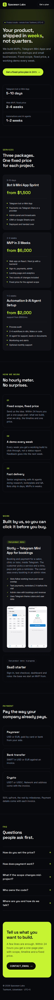

# Spaceson Labs site

One-page site for Spaceson Labs, a product studio that builds MVPs, Telegram Mini Apps and automations. Static Astro + Tailwind, no client-side JavaScript.

| Desktop | Mobile |
|---|---|
|  |  |

All copy (packages, prices, FAQ, payment methods, demos) lives in `src/config.ts`. Before going live, replace `CONTACT_EMAIL` there with the real address.

## Run

```bash
pnpm install
pnpm dev       # http://localhost:4321
pnpm build     # static site in dist/
pnpm preview   # serve dist/
```

`SITE_BASE` sets the path the site lives under (default `/`), `SITE_URL` the full origin used for the OG image URL:

```bash
SITE_URL=https://<user>.github.io SITE_BASE=/<repo>/ pnpm build
```

## Deploy to GitHub Pages

1. Push this repo to GitHub.
2. Settings → Pages → Source: **GitHub Actions**.
3. Add `.github/workflows/deploy.yml`:

   ```yaml
   name: Deploy
   on:
     push:
       branches: [main]
   permissions:
     contents: read
     pages: write
     id-token: write
   jobs:
     build:
       runs-on: ubuntu-latest
       steps:
         - uses: actions/checkout@v4
         - uses: withastro/action@v3
           env:
             SITE_URL: https://${{ github.repository_owner }}.github.io
             SITE_BASE: /${{ github.event.repository.name }}/
     deploy:
       needs: build
       runs-on: ubuntu-latest
       environment:
         name: github-pages
         url: ${{ steps.deployment.outputs.page_url }}
       steps:
         - id: deployment
           uses: actions/deploy-pages@v4
   ```

4. Push to `main`; the site appears at `https://<user>.github.io/<repo>/`.
5. Custom domain: add it under Settings → Pages, point a CNAME to `<user>.github.io`, and build with `SITE_URL=https://<domain>` and `SITE_BASE=/`.
